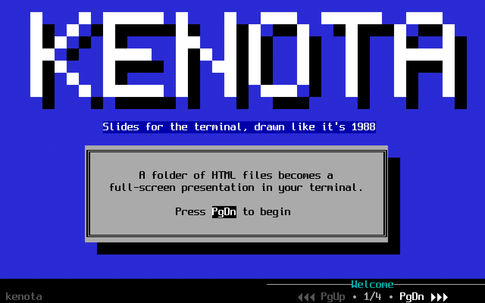
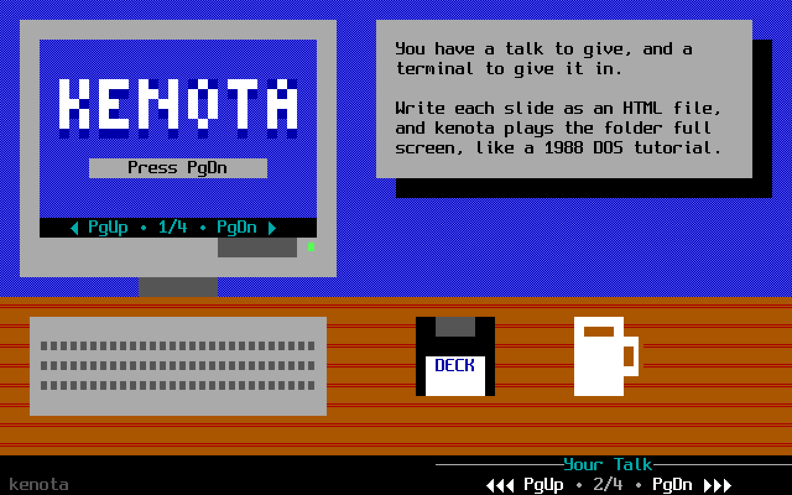
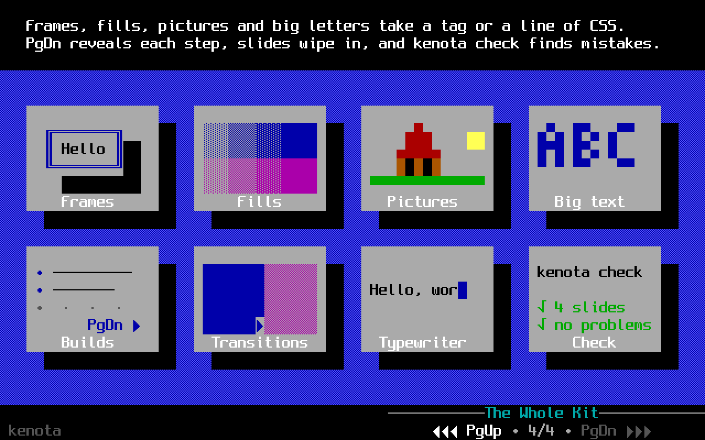
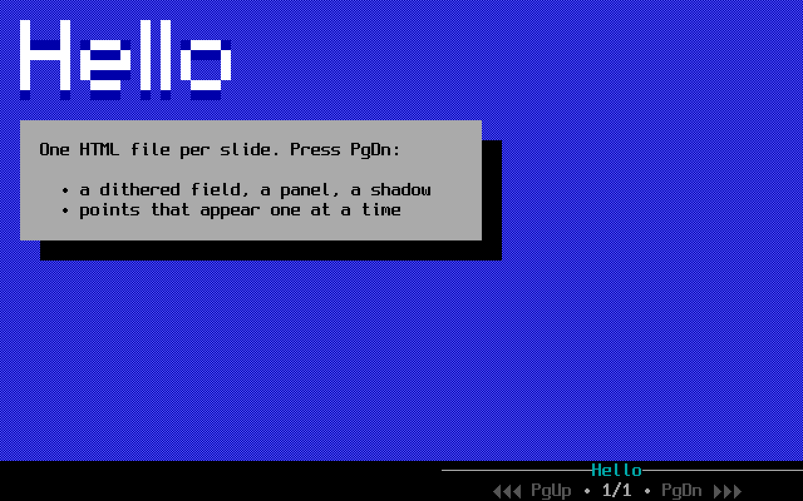

# kenota

kenota turns a folder of HTML files into a full-screen presentation in your
terminal, drawn like the 1988 Microsoft Works DOS tutorials: 16 EGA colors,
box drawing, ░▒▓ fills and drop shadows, with charts, build steps and transitions.






<sub>Drawn by kenota itself: `kenota render decks/readme --slide 1 --png docs/readme-1.png --scale 2`</sub>

## Install

```sh
cargo install kenota      # or, from a clone: cargo install --path .
```

```sh
kenota decks/demo                # present it: PgDn / PgUp, q quits
kenota check decks/demo          # list problems in a deck
kenota render decks/demo -s 3    # print a slide; --png FILE saves a picture
```

## Claude Code skill

kenota comes with a [skill](skills/) that teaches Claude Code the Works style:
Claude writes the slides, runs `kenota check` and looks at every slide before
handing the deck over. With kenota installed, add the skill with one command:

```sh
claude plugin install kenota --marketplace alejandroqh/kenota
```

Inside Claude Code, the same command is `/plugin install kenota --marketplace alejandroqh/kenota`.
Then start a new session and ask for a deck: *"make a kenota deck about our Q3 sales"*.
To update it later, run `claude plugin marketplace update kenota && claude plugin update kenota@kenota`.

## Tutorial

A deck is a folder with one HTML file per slide. Save this as `hello/01-hello.html`:

```html
<title>Hello</title>
<style>
  body { background: blue; --fill: medium lightblue; }
  .panel { width: 46; padding: 1 2; background: lightgray; color: black; box-shadow: 2 1; }
  .panel ul { margin: 0; }
</style>
<body>
  <h1>Hello</h1>
  <div class="panel">
    <p>One HTML file per slide. Press PgDn:</p>
    <ul data-build>
      <li>a dithered field, a panel, a shadow</li>
      <li>points that appear one at a time</li>
    </ul>
  </div>
</body>
```

Every size is in character cells: `width: 46` is 46 columns and `box-shadow: 2 1`
puts the shadow 2 columns right and 1 row down. `--fill` dithers the background
and `data-build` reveals the list one item per PgDn. Check the deck, then present it:

```sh
kenota check hello    # hello: 1 slide, no problems
kenota hello          # PgDn shows each point, q quits
```



Add `02-next.html` for the next slide (slides play in file-name order), a
`style.css` that every slide shares, and a `deck.toml` with `transition = "dissolve"`.
[components.md](skills/kenota/references/components.md) lists every tag and
CSS property kenota understands, and `decks/demo` uses them all. Or let
Claude write the deck: the [Claude Code skill](#claude-code-skill) knows the
style and checks its own slides.

## Contributing

Issues and pull requests are welcome. Before opening one, run `cargo test`,
`cargo clippy --all-targets` and `kenota check decks/demo`.

## License

Apache-2.0, see [LICENSE](LICENSE). Pictures are drawn with the
[Spleen](https://github.com/fcambus/spleen) font by Frederic Cambus
(BSD-2-Clause, see [its license](src/fonts/LICENSE-spleen)).
