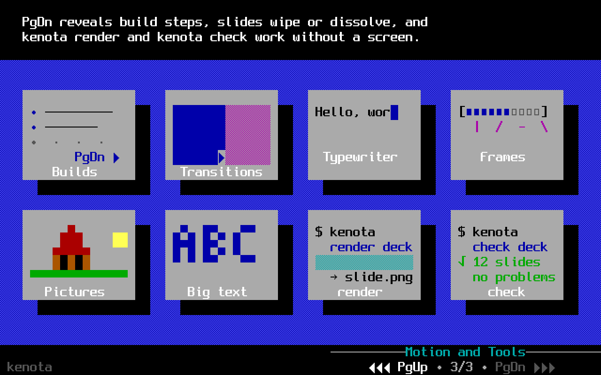

# kenota

kenota turns a folder of HTML files into a full-screen presentation in your
terminal, drawn like the 1988 Microsoft Works DOS tutorials: 16 EGA colors,
box drawing, ░▒▓ fills and drop shadows, with charts, build steps and transitions.




<sub>Drawn by kenota itself: `kenota render decks/readme --slide 1 --png docs/readme-1.png --scale 2`</sub>

## Install

```sh
cargo install kenota      # or, from a clone: cargo install --path .
```

```sh
kenota decks/demo                # present it: PgDn / PgUp, q quits
kenota check decks/demo          # list problems in a deck
kenota render decks/demo -s 3    # print a slide; --png FILE saves a picture
```

A [Claude Code skill](skills/) can write decks in this style for you.

## Contributing

Issues and pull requests are welcome. Before opening one, run `cargo test`,
`cargo clippy --all-targets` and `kenota check decks/demo`.

## License

Apache-2.0, see [LICENSE](LICENSE). Pictures are drawn with the
[Spleen](https://github.com/fcambus/spleen) font by Frederic Cambus
(BSD-2-Clause, see [its license](src/fonts/LICENSE-spleen)).
